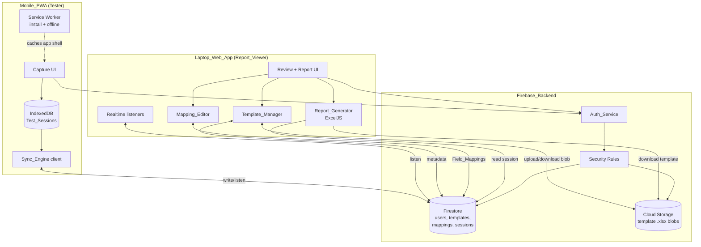
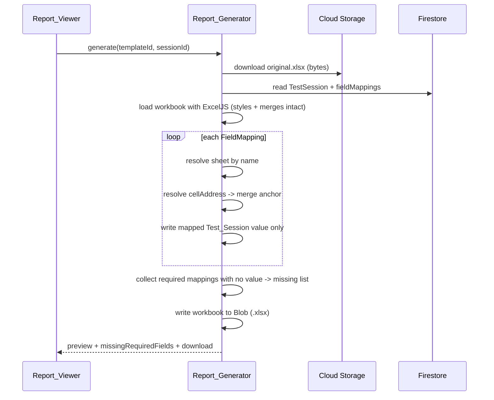
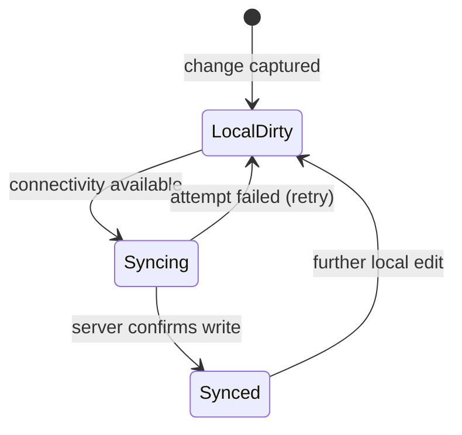

# Design Document

## Overview

The R&H Tyre Testing System is a Firebase-backed application with two coordinated front-end experiences that share one data backend:

- **Mobile_PWA** — an installable, offline-capable web app testers use during and after driving to capture subjective Ride & Handling (R&H) evaluations with minimal taps.
- **Laptop_Web_App** — a web app Report_Viewers use at the office to review synchronized Test_Session data and generate/export reports in each customer's exact Excel format.

The defining engineering challenge is that there is **no fixed report template**. Each customer (MSIL/Maruti, Renault, TATA, Hyundai) supplies its own Excel workbook, frequently multi-sheet (for example `R&H` / `Ride Comfort` / `Handling and Steering`, or `Tabelle` / `dryhandling1` / `dryhandling2` / `Description`). The system must let users upload these templates, map template cells to Mobile_PWA input fields in an in-app Mapping_Editor, and later regenerate output that is faithful to the original workbook — same sheets, sheet order, sheet names, merged cells, and cell formatting — with only the mapped Test_Session values injected into their mapped cells (Requirements 2, 3, 8).

The second challenge is **offline-first reliability**. Testers work where connectivity is poor. Every value must be persisted locally before a saved confirmation is shown (Requirement 10.1), autosaved within 2 seconds (Requirement 5.3), survive an unexpected close (Requirement 10.2), and synchronize automatically when connectivity returns (Requirements 4.5, 7). The laptop must reflect changes in real time without a manual reload (Requirement 7.2).

This design describes the architecture, the template/mapping engine, the report generation pipeline, the data model, the offline/sync strategy, error handling, testing strategy, and the correctness properties that guard template fidelity and mapping round-trips.

### Key Design Decisions

| Decision | Rationale | Requirements |
|---|---|---|
| Firebase (Auth + Firestore + Cloud Storage) as the single backend | Provides authentication, real-time listeners, offline persistence primitives, and file storage without operating servers | 1, 2, 7, 10 |
| **Fidelity-by-preservation** report strategy: load the original `.xlsx`, mutate only mapped cells, never restructure | Excel formatting is fragile under full rewrite; the only reliable way to match a customer template is to keep the original workbook bytes and touch as little as possible | 8.3, 8.6 |
| ExcelJS as the workbook read/write library (client-side, in the Laptop_Web_App) | Preserves styles and merged cells on targeted cell edits and runs in the browser; generation stays close to the preview and download UX | 8.1–8.6, 9 |
| Field_Mapping keyed by `sheetName` + A1 `cellAddress` | A template cell is only unambiguous when qualified by its sheet; multi-sheet templates require this | 3.3, 8.4 |
| IndexedDB for local Test_Session persistence on mobile | Durable, structured, large-capacity local storage that survives app close; localStorage is too small and synchronous | 4.4, 5.3, 10.1, 10.2 |
| Per-field, latest-server-timestamp conflict resolution with note preservation | Matches the requirement precisely and avoids losing either tester's notes | 7.4 |

## Architecture

### System Context



### Architectural Principles

1. **Offline-first on mobile.** The Mobile_PWA treats IndexedDB as the source of truth for in-progress work. Firestore is a synchronization target, not a precondition for capture (Requirements 4.3, 4.4, 10.1).
2. **Real-time on laptop.** The Laptop_Web_App subscribes to Firestore listeners so synchronized sessions appear without reload (Requirement 7.2).
3. **Preserve, don't rebuild.** Report generation opens the stored customer workbook and writes only mapped cells, leaving everything else untouched (Requirements 3.7, 8.3).
4. **Role-scoped access.** Auth_Service assigns exactly one role; Firestore Security Rules enforce what each role may read or write (Requirement 1).
5. **Separation of layers.** Capture, sync, template/mapping, and report generation are independent modules communicating through the Firestore data model, so any one layer can change without forcing changes in the others.

### Technology Stack

| Concern | Choice | Notes |
|---|---|---|
| Front-end framework | React + TypeScript (both apps) | Shared component and model code; strong typing for the mapping/data models |
| Local storage | IndexedDB via a thin wrapper (e.g. Dexie) | Structured, durable, survives close |
| PWA shell | Web App Manifest + Service Worker (Workbox) | Install + standalone + offline app shell (Requirements 4.1, 4.2) |
| Backend | Firebase Auth, Firestore, Cloud Storage | Real-time, offline primitives, file blobs |
| Excel engine | ExcelJS | Read template, write mapped cells, export `.xlsx` |
| Voice notes | Web Speech API (progressive enhancement) | Only where the device supports it (Requirement 5.5) |

## Components and Interfaces

### Auth_Service

Wraps Firebase Auth and exposes the authenticated user plus a single role.

```typescript
type Role = 'Tester' | 'Report_Viewer';

interface AuthService {
  signIn(email: string, password: string): Promise<AuthUser>;   // R1.1, R1.2
  signOut(): Promise<void>;                                      // R1.7
  currentUser(): AuthUser | null;                                // R1.6
  onAuthChange(cb: (user: AuthUser | null) => void): Unsubscribe;
}

interface AuthUser {
  uid: string;
  email: string;
  role: Role;   // exactly one (R1.3)
}
```

- Invalid credentials surface a descriptive authentication error and access is denied (R1.2).
- The role is read from the user's Firestore `users/{uid}` document (custom claim mirror) and gates UI and Security Rules: Tester → capture on Mobile_PWA (R1.4); Report_Viewer → report generation/export on Laptop_Web_App (R1.5).
- While unauthenticated, only sign-in is reachable (R1.6).

### Template_Manager (Laptop_Web_App)

Uploads, lists, inspects, and deletes Customer_Templates.

```typescript
interface TemplateManager {
  upload(file: File, customerName: string): Promise<CustomerTemplate>;  // R2.1, R2.3
  list(): Promise<CustomerTemplateSummary[]>;                           // R2.4
  inspect(templateId: string): Promise<TemplateStructure>;             // R2.5
  delete(templateId: string, confirmed: boolean): Promise<void>;       // R2.6
}

interface TemplateStructure {
  sheets: Array<{
    name: string;
    index: number;            // preserves sheet order (R8.3)
    rowCount: number;
    columnCount: number;      // cell dimensions (R2.5)
    mergedRanges: string[];   // e.g. "A1:D1"
  }>;
}
```

- Upload validates the file is a real `.xlsx` workbook before storing; invalid files are rejected with a descriptive message (R2.3).
- The raw workbook blob is stored in Cloud Storage; sheet names and dimensions are extracted (via ExcelJS) and stored as metadata in Firestore so listing and inspection do not require re-downloading the blob (R2.2, R2.4, R2.5).
- Delete requires explicit confirmation, then removes both the Firestore metadata and the Cloud Storage blob (R2.6).

### Mapping_Editor (Laptop_Web_App)

Presents a template's sheets/cells/columns and records Field_Mappings to Mobile_PWA input fields.

```typescript
interface MappingEditor {
  begin(templateId: string): Promise<TemplateStructure>;               // R3.1
  createMapping(m: FieldMapping): MappingDraftResult;                  // R3.2, R3.3, R3.5
  loadExisting(templateId: string): Promise<FieldMapping[]>;           // R3.6
  save(templateId: string, mappings: FieldMapping[]): Promise<SaveResult>; // R3.4, R3.5
}

interface MappingDraftResult {
  accepted: FieldMapping[];
  conflicts: Array<{ mapping: FieldMapping; reason: 'duplicate-target-cell' }>;
}

interface SaveResult {
  saved: FieldMapping[];
  withheld: Array<{ mapping: FieldMapping; reason: string }>;   // R3.5
}
```

- A mapping targets a cell qualified by sheet, supporting cells on any sheet of a multi-sheet template (R3.3).
- If two distinct input fields map to the same template cell, the editor shows a conflict warning, withholds **only** the conflicting mapping, and saves the rest (R3.5).
- Editing an existing template loads previously saved mappings (R3.6).
- Cells with no mapping are recorded as such implicitly (their absence) so the Report_Generator leaves them untouched (R3.7).

### Sync_Engine (Mobile_PWA client + Laptop listeners)

```typescript
interface SyncEngine {
  enqueue(session: LocalTestSession): Promise<void>;   // local write first (R10.1)
  syncNow(): Promise<SyncOutcome>;                      // R4.5, R7.1
  onConnectivityRestored(): void;                       // triggers retry (R7.3)
  status(sessionId: string): 'unsynced' | 'syncing' | 'synced'; // R10.3, R10.4
}
```

- On the laptop, real-time listeners on the `testSessions` collection push updates to the UI without reload (R7.2).

### Report_Generator (Laptop_Web_App)

```typescript
interface ReportGenerator {
  generate(templateId: string, sessionId: string): Promise<GeneratedReport>; // R8.1–R8.6
}

interface GeneratedReport {
  workbookBlob: Blob;              // .xlsx (R9.1)
  suggestedFileName: string;       // customerName + testDate (R9.3)
  missingRequiredFields: string[]; // R8.5
  preview: ReportPreview;          // R9.4
}
```

## Data Models

### Firestore Collections

```
users/{uid}
customerTemplates/{templateId}
customerTemplates/{templateId}/fieldMappings/{mappingId}
testSessions/{sessionId}
```

Cloud Storage: `templates/{templateId}/original.xlsx` (the raw workbook blob).

#### users/{uid}

```typescript
interface UserDoc {
  uid: string;
  email: string;
  role: 'Tester' | 'Report_Viewer';   // R1.3
  createdAt: Timestamp;
}
```

#### customerTemplates/{templateId}

```typescript
interface CustomerTemplate {
  templateId: string;
  customerName: string;               // R2.1
  storagePath: string;                // Cloud Storage path to original.xlsx
  uploadDate: Timestamp;              // R2.4
  structure: TemplateStructure;       // sheets, order, dimensions, merges (R2.2, R2.5, R8.3)
  createdBy: string;                  // uid
}
```

#### Field_Mapping — customerTemplates/{templateId}/fieldMappings/{mappingId}

The Field_Mapping is the pivot of the whole system. It binds a Mobile_PWA input field to a precise location in the template, qualified by sheet.

```typescript
interface FieldMapping {
  mappingId: string;
  templateId: string;
  sheetName: string;        // which sheet (R3.3, R8.4) — REQUIRED
  cellAddress: string;      // A1-style, e.g. "C7" (R3.2)
  inputFieldKey: string;    // Mobile_PWA field, e.g. "tyreSet[0].make",
                            //   "rhParameter.smoothRoad.rating",
                            //   "vehicle.frontAxlePressure"
  fieldType: 'tyreSet' | 'vehicle' | 'condition' | 'rhRating' | 'rhNote' | 'meta';
  rhParameterName?: string; // when the mapping defines an R&H_Parameter (R6.6)
  required: boolean;        // drives missing-field reporting (R8.5)
}
```

- `(templateId, sheetName, cellAddress)` is the uniqueness key. A second mapping to the same triple is a conflict (R3.5).
- When mappings carry `rhParameterName`, the set of R&H_Parameters they define drives what the Mobile_PWA presents for that template (R6.6); absent such mappings, the app presents a default parameter set (R6.7).

#### testSessions/{sessionId}

```typescript
interface TestSession {
  sessionId: string;
  templateId: string | null;          // selected Customer_Template
  createdBy: string;                  // Tester uid

  tyreSets: TyreSet[];                // R6.1
  vehicle: VehicleDetails;            // R6.2
  conditions: TestConditions;         // R6.3
  ride: RHCategory;                   // R6.4
  handling: RHCategory;               // R6.4

  syncState: 'unsynced' | 'synced';   // R10.3, R10.4
  fieldTimestamps: Record<string, Timestamp>; // per-field server ts for conflict resolution (R7.4)
  updatedAt: Timestamp;
}

interface TyreSet {
  groupName: string;      // e.g. "Set A", "Ref", "3B-RB"
  make: string;           // Tyre Make
  pattern: string;        // Pattern
  srlr: 'SR' | 'LR' | string;
  weekCode: string;
  dot: string;            // DOT
}

interface VehicleDetails {
  vehicleId: string;      // test vehicle identifier
  tyreSize: string;
  rimSize: string;
  frontAxlePressure: number;
  rearAxlePressure: number;
}

interface TestConditions {
  testTrack: string;
  driverName: string;
  loadOfCar: string;
  airTempC: number;
  roadTempC: number;
  testDate: string;       // used for file naming (R9.3)
}

interface RHCategory {
  parameters: RHParameterEntry[];
  averageRating: number;  // derived (R6.5)
}

interface RHParameterEntry {
  name: string;           // e.g. "Smooth Road", "Damping", "Rear Tracking"
  rating: number;         // increments of 0.25 (R5.4)
  note: string;           // per-parameter note (R6.4)
}
```

### Local (IndexedDB) Model on Mobile_PWA

The Mobile_PWA stores an object store `localSessions` keyed by `sessionId`, holding the same `TestSession` shape plus a `dirty` flag and a `pendingSince` timestamp. This is the offline source of truth (Requirements 4.4, 5.6, 10.1, 10.2).

### Template & Mapping Engine

The engine has two sides that share the same Field_Mapping model.

**Ingest side (Template_Manager + Mapping_Editor):**
1. On upload, ExcelJS parses the workbook. The engine extracts `TemplateStructure` (ordered sheet names, per-sheet dimensions, merged ranges) and stores the raw blob unchanged in Cloud Storage (R2.1, R2.2).
2. The Mapping_Editor renders each sheet as a grid so the user can click a cell (or column header) and bind it to an input field, producing Field_Mappings qualified by `sheetName` + `cellAddress` (R3.1–R3.3).
3. Save validates uniqueness of target cells; conflicting mappings are withheld while the rest persist (R3.5).

**Emit side (Report_Generator):** described in the pipeline below.

Design note on cell targeting: template cells are addressed in A1 notation **per sheet**. Merged cells are always written to the top-left anchor cell of their range, because that is where Excel stores a merged region's value; writing to a non-anchor cell of a merge is a no-op in Excel and would silently lose data. The engine resolves any mapped `cellAddress` that falls inside a merged range to that range's anchor before writing.

## Report Generation Pipeline

The pipeline implements **fidelity-by-preservation** (Requirement 8).



Steps:
1. **Load original.** Download the stored workbook and open it with ExcelJS. Because the original bytes carry all styles, merges, sheet order, and sheet names, opening and re-saving without structural edits preserves them (R8.3, R8.6).
2. **Resolve mappings per sheet.** For each Field_Mapping, look up the worksheet by `sheetName`, resolve `cellAddress` (accounting for merges), and write the corresponding Test_Session value — and nothing else (R8.2, R8.4).
3. **Leave unmapped cells alone.** Cells without a mapping retain their original template content (R3.7).
4. **Report missing values.** For each `required` mapping with no session value, add the field to `missingRequiredFields` and leave that cell blank rather than aborting (R8.5).
5. **Serialize.** Write to an `.xlsx` Blob that opens in Excel without repair prompts (R8.6, R9.1).
6. **Name + preview.** Suggest `"{customerName}_{testDate}.xlsx"` (R9.3) and render a preview of populated sheets before download (R9.4). If serialization fails, show an explicit error and block download (R9.2).

### Library Trade-offs (research summary)

The report step is the highest-risk area for fidelity, so the library choice matters.

- **ExcelJS (selected):** Preserves styles and merged cells when editing targeted cells of a loaded workbook, and runs in the browser, which keeps generation, preview, and download in one place. Community reports note edge cases when **restructuring** (inserting rows, re-merging) can disturb styles or merged-cell borders ([ExcelJS PR #1102 on merged-cell borders](https://github.com/exceljs/exceljs/pull/1102); [Issue #1567 on merged cells via addRow](https://github.com/exceljs/exceljs/issues/1567)). Our pipeline deliberately avoids restructuring — it only overwrites mapped cell values — which stays within ExcelJS's reliable path ([discussion of ExcelJS preserving styles on modification](https://stackoverflow.com/questions/41861696/js-xlsx-preserve-cell-style-while-writing-to-xlsx-file)). *Content was rephrased for compliance with licensing restrictions.*
- **SheetJS (xlsx) Community edition:** Broad format support, but style read/write is a paid ("Pro") capability, so the free tier is a poor fit for fidelity-critical output.
- **SheetJS Pro:** Full styling, at a licensing cost; a fallback if ExcelJS proves insufficient for a specific customer template.

**Mitigation for fidelity:** because "faithful match" is the core promise, the design pairs the ExcelJS path with a **template-fidelity property test** (see Correctness Properties) that loads a template, writes mappings, re-reads the output, and asserts sheet names, sheet order, merged ranges, and unmapped-cell content are unchanged. If any real customer template exceeds ExcelJS's preservation ability, the isolated Report_Generator interface allows swapping the engine (e.g. to SheetJS Pro) without touching capture, sync, or mapping code.

## Offline and Sync Strategy

### Installability and Offline Shell (Requirement 4)

- A Web App Manifest plus a Service Worker (Workbox) make the app installable to the home screen (R4.1) and launch it standalone/full-screen (R4.2).
- The Service Worker precaches the app shell so the Tester can open the app and capture data with no network (R4.3).

### Local-First Capture (Requirements 5, 10)

- Every change writes to IndexedDB **before** any saved confirmation is shown (R10.1) and is autosaved within 2 seconds (R5.3).
- Reopening the app restores the most recent in-progress Test_Session with all entered values (R5.6), and locally persisted data survives an unexpected close (R10.2).
- Ratings are captured in a single tap on preset values in 0.25 increments within each parameter's configured range (R5.2, R5.4); touch targets are at least 44×44 CSS px (R5.1); dictation is offered where supported (R5.5).

### Synchronization (Requirements 4.5, 7, 10.3–10.6)



- When online, each saved change syncs to Firestore within 10 seconds (R7.1); on restore of connectivity, queued changes sync (R4.5).
- Failed attempts retain local data and retry when connectivity returns (R7.3).
- Sessions carry an `unsynced` indicator until the backend confirms storage, at which point they are marked `synced` (R10.3, R10.4).
- The laptop's Firestore listeners reflect synchronized sessions in real time without reload (R7.2).

### Conflict Resolution (Requirement 7.4)

When the same Test_Session is edited on two devices, resolution is **per field, latest server-received timestamp wins**, using the `fieldTimestamps` map stamped by the Firestore server on write. Note text is treated specially: both note texts are preserved (concatenated/kept as distinct entries) rather than one overwriting the other, satisfying "preserving both note texts."

### Retention and Deletion (Requirements 10.5, 10.6)

- Synchronized sessions are retained in Firestore until a Report_Viewer explicitly deletes them (R10.5).
- On deletion, the session is removed from Firestore and the deletion propagates (via listeners) so devices remove their local copies (R10.6).

## Correctness Properties

*A property is a characteristic or behavior that should hold true across all valid executions of a system — essentially, a formal statement about what the system should do. Properties serve as the bridge between human-readable specifications and machine-verifiable correctness guarantees.*

The properties below are derived from the acceptance criteria. Redundant criteria were consolidated: the many "capture X details" criteria (6.1–6.4) fold into a single local-persistence round-trip; the role-access criteria (1.4–1.6) fold into one access-control property; the fidelity criteria (8.3) and unmapped-cell criteria (3.7) are kept distinct because they guard different failure modes (structure vs. content).

### Property 1: Exactly one role

*For any* authenticated user produced by role assignment, the user's role is exactly one value from {Tester, Report_Viewer} — never zero and never more than one.

**Validates: Requirements 1.3**

### Property 2: Role-based access control

*For any* user (authenticated or not) and *any* protected capability, access is granted if and only if the user's role permits it: Tester → Test_Session capture, Report_Viewer → report generation/export, unauthenticated → only sign-in functions.

**Validates: Requirements 1.4, 1.5, 1.6**

### Property 3: Template structure extraction fidelity

*For any* uploaded workbook, the extracted TemplateStructure lists every sheet, in the same order, with the same sheet names and correct row/column dimensions as the source workbook.

**Validates: Requirements 2.2, 2.5**

### Property 4: Mapping save/load round-trip

*For any* valid set of Field_Mappings, saving the set and then loading it for the same Customer_Template yields an equivalent set of mappings (same sheet, cell address, input field, and required flag for each).

**Validates: Requirements 3.4, 3.6**

### Property 5: Mapping conflict handling

*For any* set of proposed Field_Mappings, after save the persisted set contains no two mappings targeting the same (sheet, cell) and equals the input set minus exactly the conflicting duplicates, while every non-conflicting mapping is saved.

**Validates: Requirements 3.5**

### Property 6: Unmapped cells are preserved

*For any* Customer_Template and *any* Test_Session, every template cell that has no Field_Mapping is identical in content to the original template cell in the generated report.

**Validates: Requirements 3.7**

### Property 7: Rating validation

*For any* numeric value, the Mobile_PWA accepts it as a Rating if and only if it lies within the R&H_Parameter's configured range and is a multiple of 0.25.

**Validates: Requirements 5.4**

### Property 8: Local Test_Session persistence round-trip

*For any* Test_Session state (including all Tyre_Set, vehicle, condition, and per-parameter rating/note fields), persisting it to local storage and then reloading it yields an identical Test_Session state.

**Validates: Requirements 4.4, 5.6, 6.1, 6.2, 6.3, 6.4, 10.2**

### Property 9: Category average derivation

*For any* non-empty set of R&H_Parameter Ratings within a category, the derived category average equals the arithmetic mean of those Ratings.

**Validates: Requirements 6.5**

### Property 10: R&H_Parameter set selection

*For any* Customer_Template, the R&H_Parameters presented on the Mobile_PWA equal exactly the parameters defined by that template's Field_Mappings when such mappings exist, and equal the default parameter set when no such mappings exist.

**Validates: Requirements 6.6, 6.7**

### Property 11: Failed sync retains and retries

*For any* queued Test_Session change under a failing sync transport, the change remains in local storage and a retry is scheduled for when connectivity is available.

**Validates: Requirements 7.3**

### Property 12: Per-field conflict merge

*For any* two versions of the same Test_Session with per-field server timestamps, the merged result takes, for each field, the value carrying the latest server-received timestamp, and preserves both note texts.

**Validates: Requirements 7.4**

### Property 13: Mapped cells are written across all sheets

*For any* Test_Session and *any* Field_Mapping set (including mappings spanning multiple sheets), each mapped cell in the generated report holds the Test_Session value for its input field, at the exact sheet and cell address defined by the mapping.

**Validates: Requirements 3.3, 8.2, 8.4**

### Property 14: Output structural fidelity

*For any* Customer_Template and *any* Test_Session, the generated report preserves the template's sheet set, sheet names, sheet order, merged cell ranges, and cell formatting.

**Validates: Requirements 8.3**

### Property 15: Missing required fields are reported and left blank

*For any* Test_Session that omits values for one or more required mapped fields, the generated report lists exactly those missing fields and leaves precisely those mapped cells blank.

**Validates: Requirements 8.5**

### Property 16: Generated workbook re-parses validly

*For any* generated report, re-loading the output workbook with the Excel library succeeds without error, producing a well-formed workbook (a round-trip that approximates opening in Excel without repair prompts).

**Validates: Requirements 8.6**

### Property 17: Download filename format

*For any* customer name and Test_Session test date, the suggested download filename equals the deterministic pattern combining the customer name and the test date with an `.xlsx` extension.

**Validates: Requirements 9.3**

### Property 18: Sync-status invariant

*For any* Test_Session, its status is `synced` if and only if the Firebase_Backend has confirmed its storage; otherwise it is `unsynced`.

**Validates: Requirements 10.3, 10.4**

## Error Handling

| Area | Condition | Handling | Requirements |
|---|---|---|---|
| Auth | Invalid credentials | Deny access, show authentication error, stay on sign-in | 1.2 |
| Auth | Unauthenticated navigation | Redirect to sign-in; restrict all other routes | 1.6 |
| Template upload | Not a valid `.xlsx` | Reject before storing, show descriptive error naming the problem | 2.3 |
| Template delete | Missing confirmation | Do not delete until user confirms | 2.6 |
| Mapping save | Duplicate target cell | Warn, withhold only the conflicting mapping, save the rest | 3.5 |
| Capture (offline) | No network | Continue capturing to IndexedDB; show `unsynced` indicator | 4.3, 4.4, 10.3 |
| Rating input | Out-of-range or non-0.25 value | Reject the value; keep prior valid value | 5.4 |
| Sync | Transient failure | Retain local data, schedule retry on connectivity | 7.3 |
| Sync | Concurrent edits | Per-field latest-server-timestamp merge; preserve both notes | 7.4 |
| Report generation | Required field missing | Continue; list missing fields; leave those cells blank | 8.5 |
| Report generation | Workbook serialization fails | Show explicit error, block download | 9.2 |
| Report generation | Sheet named in a mapping not found in template | Skip that mapping, record a generation warning surfaced in preview | 8.1, 8.3 |
| Retention | Delete a synchronized session | Remove from Firestore; propagate to remove local copies | 10.6 |

General approach: capture-side errors never block the tester (data is always retained locally first); generation-side errors are surfaced explicitly to the Report_Viewer and never produce a silently corrupt or partial download.

## Testing Strategy

The system uses a dual approach: **property-based tests** for input-varying logic (the template/mapping engine, report generation, conflict merge, validation, averaging, and persistence round-trips) and **example/integration/smoke tests** for external services, UI, and configuration.

### Property-Based Testing

PBT is appropriate here because the highest-risk logic is pure and input-varying: template structure extraction, Field_Mapping round-trips and conflict resolution, mapped-cell writing, template fidelity, rating validation, category averaging, per-field conflict merge, and local persistence round-trips. These have clear "for all inputs" statements and benefit from broad randomized coverage (odd sheet names, merged ranges, multi-sheet layouts, boundary ratings, concurrent-edit timestamp orderings).

- **Library:** [fast-check](https://github.com/dubzzz/fast-check) for TypeScript. The design MUST NOT implement property testing from scratch.
- **Iterations:** each property test runs a minimum of 100 iterations.
- **Coverage:** one property-based test per correctness property (Properties 1–18).
- **Tagging:** each test is tagged with a comment referencing its design property, in the format:
  **Feature: rnh-tyre-testing-system, Property {number}: {property_text}**
- **Generators:** custom arbitraries produce randomized workbooks (varying sheet counts, names, dimensions, merged ranges), Field_Mapping sets (including intentional duplicate targets), Test_Sessions (all field types, including missing required fields and full unicode notes), and rating values (in-range, out-of-range, off-grid). Generators explicitly include edge cases: empty parameter lists, non-`.xlsx` byte inputs, cells inside merged ranges, and non-ASCII sheet names.

The template-fidelity properties (P6, P13, P14, P16) are the linchpin: they load a real/generated template, run generation, re-read the output, and assert that structure and unmapped content are unchanged while mapped cells carry the right values. These directly guard the system's core promise and would catch any regression in the ExcelJS preservation path (see Library Trade-offs).

### Example-Based Unit Tests

For specific scenarios and error cases that do not vary meaningfully with input: sign-out flow (1.7), template listing projection (2.4), delete-requires-confirm (2.6), single-tap rating capture (5.2), autosave-within-2s with fake timers (5.3), dictation with a mocked Speech API (5.5), download blob type (9.1), generation-failure error + blocked download (9.2), and preview rendering (9.4).

### Integration Tests (1–3 examples each)

For external Firebase behavior and cross-device flows, run against the Firebase Emulator Suite: valid sign-in (1.1), upload storing blob + metadata (2.1), offline open-and-capture (4.3), offline-then-restore sync (4.5), 10-second propagation (7.1), laptop live update via listener (7.2), and delete propagation to local copies (10.6).

### Smoke / Configuration Tests

Single-execution checks for PWA setup: install offer / manifest presence (4.1) and standalone display mode (4.2).

### UI / Layout Assertions

Touch-target measurement (≥ 44×44 CSS px) on rendered rating controls (5.1), asserted via DOM measurement in component tests.

### Security Rules Tests

Firestore Security Rules are tested with the emulator to confirm role-based access matches Property 2: Testers can write their own Test_Sessions but not templates; Report_Viewers can read sessions and manage templates/mappings; unauthenticated access is denied.
