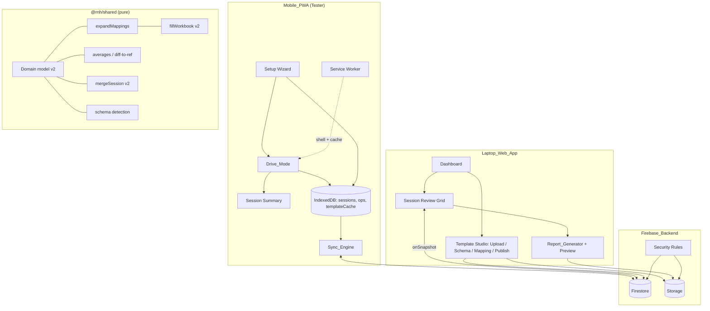
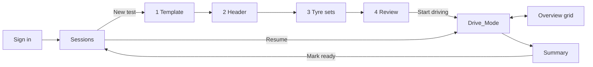

# Design Document (v2)

> v2 replaces `archive/design.v1.md` and implements `requirements.md` (v2). Defaults confirmed by "continue": 9-button pad at ±1.0 around the anchor, 600 ms auto-advance (can be turned off), 1–10 scale in 0.25 steps, Testers edit only sessions they created or are assigned to, and a one-time v1 → v2 migration.
>
> **Platform constraints (confirmed):** Firebase is used only for Auth, Firestore, and Cloud Storage. **No Cloud Functions** (no triggers, no scheduled jobs, no callable functions). Everything a server job would normally do (role changes, migration, permanent trash deletion) runs either in the client under security rules or as a local Admin SDK script in `tools/`. No git workflow is assumed.

## Overview

The system captures a **Rating_Matrix** (R&H_Parameters × Tyre_Sets, with a rating and comment per cell) on an offline-first Mobile_PWA. It syncs through Firebase and fills the customer's own Excel workbook on the Laptop_Web_App.

Three engines carry the product:

1. **Template engine**: turns an uploaded customer workbook into a versioned `Template_Schema` (categories, parameters, header fields, scale, slots) and a set of `Block_Mapping`s and `Cell_Mapping`s created by selecting regions.
2. **Capture engine**: Drive_Mode on the phone. One parameter per screen, a 9-button pad around the anchor, quick comments and voice, auto-advance, undo. Every tap is written to IndexedDB before the UI shows it as saved.
3. **Report engine**: the fidelity-by-preservation fill from v1, extended to expand block mappings, never write into formula cells, write Unrated cells as empty, and set Excel to recalculate on open.

### Key Design Decisions

| Decision | Rationale | Req |
|---|---|---|
| Keep React + TS monorepo, Vite, Dexie, Firebase (Auth/Firestore/Storage), ExcelJS, vite-plugin-pwa, Vitest + fast-check | Already in place, tested and green (61 files / 326 tests). v2 changes the domain model, not the stack | all |
| Keep the v1 fill approach: load original bytes, write mapped cells, save | Proven by the v1 fidelity properties. Extended rather than replaced | 11 |
| Rating_Matrix stored as a **map keyed by `paramId__tyreSetId`**, not arrays | Lets a single Firestore field path update (`cells.p3__t2.rating`) sync one cell without overwriting others, and gives natural per-cell conflict merge | 9.4, 9.5 |
| Stable ids (`paramId`, `tyreSetId`, `fieldId`) and display names kept separate | Renames in the schema must not break captured data or mappings | 3.3 |
| `rating: number \| null` (null = Unrated) | Removes the v1 bug where blank showed as `min` (1) and pulled averages down | 7.2 |
| Immutable `Template_Version` documents + a Storage blob per version | Sessions pin a version, so old reports always regenerate identically | 2.4, 2.5, 11.1 |
| Roles as `roles: Role[]` on `users/{uid}`, written only by Admin SDK/Template_Admin tooling | One engineer can drive and report. Clients can't escalate their own roles | 1.3, 14.4 |
| Mapping expansion is a **pure function** `expandMappings(version) → ResolvedTarget[]` | The Mapping_Editor highlight, coverage, Test fill and generator all use the same expansion, so what you see is what gets written | 4.5, 4.9, 4.10, 11 |
| No Cloud Functions; the trash and deletion propagation use tombstones | Matches the current no-server deployment (docs/SETUP.md) | 13 |

## Architecture



### Principles

1. **Offline-first on mobile.** IndexedDB is the source of truth. Firestore is where it syncs to.
2. **Pure core.** Schema detection, mapping expansion, averages, validation, merge and fill live in `@rnh/shared` with no React or Firebase imports, and are covered by property tests.
3. **Preserve, don't rebuild.** Only resolved mapping targets are written, and formula cells are never written.
4. **One expansion.** Every consumer of mappings goes through `expandMappings`.
5. **Rules enforce, UI hints.** Every role check is duplicated in the security rules.

## Data Models

All types live in `packages/shared/src/model/` (v2) and replace the v1 types in `packages/shared/src/index.ts`. Timestamps stay epoch ms (`Timestamp = number`).

### Users and roles

```typescript
type Role = 'Tester' | 'Report_Viewer' | 'Template_Admin';

interface UserDoc {            // users/{uid}
  uid: string;
  email: string;
  displayName: string;         // prefills "Tested by" (R5.4)
  roles: Role[];               // one or more (R1.3); never self-writable (R14.4)
  createdAt: Timestamp;
}
```

### Template schema

```typescript
interface RatingScale {
  min: number;                 // default 1
  max: number;                 // default 10
  step: 0.25 | 0.5;            // default 0.25 (R3.5)
  pointLabels?: Record<string, string>; // "7" -> "satisfactory"
}

interface CategoryDef { categoryId: string; name: string; order: number }

interface ParameterDef {
  paramId: string;             // stable, e.g. "p_basicRide"
  categoryId: string;
  name: string;                // as in the sheet: "Basic ride (Pitch/bounce/...)"
  shortName?: string;          // Drive_Mode label: "Basic ride" (R3.4)
  description?: string;
  weight?: number;             // Hyundai 0.1–0.4 (R3.4, R7.4)
  order: number;
}

type HeaderFieldType = 'text' | 'number' | 'date' | 'choice' | 'pressure';

interface HeaderFieldDef {
  fieldId: string;             // e.g. "h_reportNr", "h_weather"
  label: string;
  type: HeaderFieldType;
  unit?: string;               // "psi" | "kPa" | "°C"
  choices?: string[];          // for 'choice'
  required: boolean;
  defaultValue?: string | number;
  prefill?: 'today' | 'userDisplayName' | 'lastSession';
}

/** Per-Tyre_Set detail keys a slot Cell_Mapping can target (R4.4). */
type TyreDetailKey =
  | 'label' | 'make' | 'pattern' | 'size' | 'srlr' | 'weekCode'
  | 'dot' | 'compound' | 'airTempC' | 'roadTempC' | 'overallComment';

interface TemplateSchema {
  categories: CategoryDef[];
  parameters: ParameterDef[];
  headerFields: HeaderFieldDef[];
  scale: RatingScale;
  slotCount: number;           // max Tyre_Sets (R5.5, R11.5)
  quickComments: string[];     // (R3.6)
  fileNamePattern: string;     // (R12.4)
}
```

### Mappings

```typescript
interface BlockMapping {
  kind: 'block';
  mappingId: string;
  sheetName: string;
  rows: { row: number; paramId: string }[];  // 1-based sheet rows (R4.2)
  firstSlot: number;           // 1-based Tyre_Slot this block starts at (R4.3)
  slotCount: number;           // slots covered by this block
  firstColumn: number;         // 1-based column of slot `firstSlot`
  stride: number;              // columns between slots (M&M: 2, MSIL: 4)
  ratingOffset: number;        // column offset of the rating cell (usually 0)
  commentOffset: number | null;// offset of the comment cell (usually 1), null = none
}

interface HeaderCellMapping {
  kind: 'header';
  mappingId: string;
  sheetName: string;
  cellAddress: string;         // A1
  fieldId: string;
}

interface SlotCellMapping {
  kind: 'slotDetail';
  mappingId: string;
  sheetName: string;
  detail: TyreDetailKey;
  cells: { slot: number; cellAddress: string }[];  // one per slot
}

type Mapping = BlockMapping | HeaderCellMapping | SlotCellMapping;

/** Output of expandMappings: one concrete cell to write. */
interface ResolvedTarget {
  sheetName: string;
  cellAddress: string;         // merge master, already redirected (R4.8)
  source:
    | { kind: 'rating'; paramId: string; slot: number }
    | { kind: 'comment'; paramId: string; slot: number }
    | { kind: 'header'; fieldId: string }
    | { kind: 'slotDetail'; detail: TyreDetailKey; slot: number };
  mappingId: string;
}
```

Worked example, M&M `R&H ` sheet: one block with `rows = 8..26` (19 params), `firstSlot = 1`, `slotCount = 8`, `firstColumn = 5` (E), `stride = 2`, `ratingOffset = 0`, `commentOffset = 1`. Slot 1 (Reference) writes E/F, slot 2 (MU1) G/H and so on up to slot 8 (MU7) S/T. MSIL uses two blocks: `dryhandling1` for slots 1–4 starting at column D, stride 4, and `dryhandling2` for slots 5–8 at the same columns.


### Template documents and versions

```typescript
interface CustomerTemplate {   // customerTemplates/{templateId}
  templateId: string;
  customerName: string;        // "MSIL", "M&M", "Hyundai"
  templateName: string;        // "Dry handling 8-set"
  status: 'draft' | 'published' | 'archived';   // (R2.7)
  latestVersion: number | null;                 // null until first publish
  draft: {                                      // editable working copy (R2.5)
    storagePath: string;       // templates/{id}/draft.xlsx
    structure: TemplateStructure;               // v1 type + formulaCells
    schema: TemplateSchema;
    mappings: Mapping[];
  };
  sessionCount: number;        // (R2.6) maintained by client on session create
  createdBy: string; createdAt: Timestamp;
  updatedBy: string; updatedAt: Timestamp;      // (R13.5)
}

interface TemplateVersion {    // customerTemplates/{id}/versions/{n} - immutable
  templateId: string;
  version: number;             // 1, 2, 3...
  storagePath: string;         // templates/{id}/v{n}.xlsx - immutable blob
  structure: TemplateStructure;
  schema: TemplateSchema;
  mappings: Mapping[];
  publishedBy: string; publishedAt: Timestamp;
}

interface SheetStructure {     // v1 fields kept, two added
  name: string; index: number; rowCount: number; columnCount: number;
  mergedRanges: string[];
  formulaCells: string[];      // A1 addresses holding formulas (R4.6, R11.4)
  columnWidths: number[];      // for grid preview (R2.3, R12.1)
}
```

Mappings and schema are stored inline on the version (a few KB for 20 params × 8 slots), so a Tester's phone caches one document per version plus nothing else (R8.4). The workbook blob is only needed on the laptop.

### Test session

```typescript
type SessionStatus = 'in_progress' | 'ready' | 'reported';

interface TyreSet {
  tyreSetId: string;           // stable, e.g. "t_k3f9"
  slot: number;                // 1-based, = order (R5.7)
  isReference: boolean;        // exactly one true (R5.5)
  label: string;               // "Ref", "MU1", "3B-RB"
  make: string; pattern: string; size: string; srlr: string;
  weekCode: string; dot: string; compound: string;
  airTempC: number | null; roadTempC: number | null;
  overallComment: string;
  photoPaths: string[];        // sessions/{sid}/photos/{file} (R5.8)
}

interface RatingCell {
  rating: number | null;       // null = Unrated (R7.2)
  comment: string;
  updatedAt: Timestamp;        // client time; server time in fieldTimestamps
  updatedBy: string;
}

interface TestSession {        // testSessions/{sessionId}
  sessionId: string;
  schemaVersion: 2;
  templateId: string;
  templateVersion: number;     // pinned (R5.1, R11.1)
  customerName: string;        // denormalised for list/filter (R10.1)
  status: SessionStatus;
  createdBy: string; assignedTo: string[];      // (R14.2)
  header: Record<string, string | number | null>;   // fieldId -> value
  tyreSets: Record<string, TyreSet>;            // keyed by tyreSetId
  cells: Record<string, RatingCell>;            // key = `${paramId}__${tyreSetId}`
  fieldTimestamps: Record<string, Timestamp>;   // path -> server ts (R9.4)
  history?: never;             // history lives in a subcollection (R10.4)
  progress: { rated: number; total: number };   // derived, for list (R10.1)
  lastReport?: { at: Timestamp; by: string; templateVersion: number }; // (R12.5)
  deletedAt: Timestamp | null; deletedBy: string | null;   // trash (R13.2)
  createdAt: Timestamp; updatedBy: string; updatedAt: Timestamp;
}

interface LocalTestSession extends TestSession {
  dirtyPaths: string[];        // field paths changed since last push
  syncState: 'saved_local' | 'syncing' | 'synced' | 'error';  // (R8.6)
  lastError: string | null;
  cursor: { paramId: string; tyreSetId: string; order: 'byTyre' | 'byParam' }; // (R8.2)
}
```

`cells` keys use ids, never display names, so renaming "Smooth Road" in a later template version cannot orphan data. A missing key and `rating: null` both mean Unrated.

Edit history: `testSessions/{sid}/history/{autoId}` = `{ path, before, after, by, at }`, appended by the laptop on every edit and by the Sync_Engine for each pushed path (R10.4).

### Firestore and Storage layout

| Path | Contents |
|---|---|
| `users/{uid}` | UserDoc |
| `customerTemplates/{tid}` | CustomerTemplate (draft inline) |
| `customerTemplates/{tid}/versions/{n}` | TemplateVersion (immutable) |
| `testSessions/{sid}` | TestSession |
| `testSessions/{sid}/history/{hid}` | edit audit entries |
| Storage `templates/{tid}/draft.xlsx` | draft workbook |
| Storage `templates/{tid}/v{n}.xlsx` | published workbook (immutable) |
| Storage `sessions/{sid}/photos/{file}` | tyre photos |

Composite indexes: `testSessions (deletedAt, updatedAt desc)`, `testSessions (createdBy, updatedAt desc)`, `testSessions (templateId, updatedAt desc)`.


## Components and Interfaces

### Shared core (`@rnh/shared`, pure)

```typescript
// model/rating.ts
function isValidRating(v: number, scale: RatingScale): boolean;            // R7.1
function padValues(anchor: number, scale: RatingScale, size = 9): number[]; // R6.2
function categoryAverage(s: TestSession, v: TemplateVersion,
  categoryId: string, tyreSetId: string): number | undefined;              // R7.3
function weightedCategoryAverage(...same): number | undefined;             // R7.4
function diffToReference(s: TestSession, paramId: string,
  tyreSetId: string): number | undefined;                                   // R7.5
function progress(s: TestSession, v: TemplateVersion): { rated: number; total: number };

// template/detect.ts
function proposeSchema(ws: SheetGrid, nameRange: string,
  categoryCol?: number): { schema: Partial<TemplateSchema>; excludedRows: number[] }; // R3.1, R3.2
function proposeBlock(ws: SheetGrid, region: string,
  schema: TemplateSchema): BlockMapping;                                     // R4.1, R4.2

// template/expand.ts
function expandMappings(v: Pick<TemplateVersion, 'structure' | 'mappings'>):
  { targets: ResolvedTarget[]; problems: MappingProblem[] };                  // R4.5–4.8, R4.10
type MappingProblem =
  | { kind: 'formulaCell'; sheetName: string; cellAddress: string; formula: string; mappingId: string }
  | { kind: 'duplicateTarget'; sheetName: string; cellAddress: string; mappingIds: [string, string] }
  | { kind: 'mergeRedirect'; from: string; to: string; mappingId: string }  // info, not blocking
  | { kind: 'sheetMissing'; sheetName: string; mappingId: string };
function validateForPublish(draft: CustomerTemplate): MappingProblem[] | SchemaProblem[]; // R3.8

// report/fillWorkbookV2.ts
function fillWorkbookV2(bytes: WorkbookBytes, version: TemplateVersion,
  session: TestSession): Promise<FillResultV2>;                              // R11
function testFill(bytes: WorkbookBytes, version: TemplateVersion): Promise<Uint8Array>; // R4.9

// sync/mergeSessionV2.ts
function mergeSessionV2(local: LocalTestSession, remote: TestSession): TestSession; // R9.4

// migrate/v1ToV2.ts
function migrateSessionV1(s: TestSessionV1, v: TemplateVersion): TestSession;
```

`SheetGrid` is a light, serialisable read of a sheet (values, formulas, merges, widths) built once from ExcelJS on upload, so detection and preview never touch ExcelJS directly.

`padValues(anchor)` returns `anchor − 1.0 … anchor + 1.0` in scale steps, clamped to the scale and shifted (not truncated) at the ends so the pad always shows 9 values. The anchor is the Reference_Set's rating for the parameter; if none, the last rating entered in this session; else the scale midpoint rounded to the step.

### Mobile_PWA

| Module | Responsibility | Req |
|---|---|---|
| `app/Shell` | Bottom tab bar (Sessions, Drive, Summary, Settings), sync badge, theme toggle, install prompt | 8.6, 8.7, 6.12 |
| `sessions/SessionList` | In-progress + recent sessions, "New test" FAB, sync state per row | 8.6 |
| `setup/SetupWizard` | 4 steps: Template → Header → Tyre sets → Review; per-type inputs, prefill, suggestions, reorder, photo | 5.* |
| `drive/DriveMode` | One-parameter screen, `RatingPad`, `CommentBar`, auto-advance, undo, overview grid, order switch, wake lock | 6.* |
| `drive/useCursor` | Next/prev/jump over (param × tyreSet) in `byTyre` or `byParam` order, persisted in `cursor` | 6.9, 6.10, 8.2 |
| `drive/useUndo` | In-memory stack of `{key, before}` for the session (max 50) | 6.13 |
| `summary/SessionSummary` | Per-tyre category averages, diff to ref, unrated list, missing required header fields, "Mark ready" | 5.9, 7.5 |
| `local/db` (Dexie v2) | Stores `sessions`, `templateVersions`, `suggestions`, `photos`; `persist()` request | 8.1–8.5 |
| `sync/SyncEngine` | Push `dirtyPaths` via `updateDoc` field paths; pull remote on open; backoff; tombstone handling | 9.*, 13.3 |

### Laptop_Web_App

| Module | Responsibility | Req |
|---|---|---|
| `shell/AppShell` | Left nav: Dashboard, Sessions, Templates, Trash; header with user + roles; routes via hash router | 1.4–1.6 |
| `sessions/SessionTable` | Filter/search table with completeness bar and status | 10.1 |
| `review/ReviewGrid` | Editable matrix grouped by category, keyboard nav, averages + Δ ref, unrated highlight, history popover | 10.2–10.6 |
| `review/HeaderPanel` + `TyreSetPanel` | Edit header fields and tyre details | 10.3 |
| `templates/TemplateStudio` | Stepper: Upload → Schema → Mapping → Check → Publish | 2.*, 3.*, 4.* |
| `templates/SheetGridView` | Virtualised Excel-like grid with merges, widths, formula badges, selection, colour overlays | 2.3, 4.5, 12.1 |
| `report/ReportDialog` | Pre-flight list (missing/unmapped), generate, preview, download, record `lastReport` | 11.*, 12.* |
| `trash/TrashList` | Restore / permanent delete within 30 days | 13.2 |


## User Flows and Screen Design

### Mobile_PWA flow



- **Sessions**: cards for in-progress tests first (customer, vehicle, `42 / 152 rated`, sync chip), then recent ones. A large "New test" button sits at the bottom within thumb reach. Opening the app resumes the last in-progress test directly when it was left in Drive_Mode (R8.2).
- **Setup step 1, Template**: customer tiles with the template name and version. Offline, only cached versions are shown (R8.3, R8.4).
- **Setup step 2, Header**: one field per row. Numeric keypad for numbers/pressures with a unit suffix, date picker, chips for choices (e.g. weather Sunny/Cloudy/Rain). Prefilled values are marked "from last test" so they can be checked at a glance (R5.3, R5.4).
- **Setup step 3, Tyre sets**: a reorderable list, one card per set with label, Reference toggle (exactly one), make/pattern/size with suggestions, "copy from previous", and a camera button. The slot number shown on each card equals its report column (R5.5–R5.8). Adding past `slotCount` is disabled with the reason shown.
- **Setup step 4, Review**: counts, missing required fields (warning, not blocking, R5.9), capture order choice, "Start driving".

### Drive_Mode screen (portrait, one-handed)

```
┌───────────────────────────────┐
│ MU3 · Handling      7 / 19  ● │  tyre label, category, position, sync dot
│ Yaw control                   │  shortName, 28px bold
│ Ref 7 · MU1 6.5 · MU2 6.75    │  other tyres for this parameter (R6.8)
├───────────────────────────────┤
│  [ 5.0 ]  [ 5.25 ]  [ 5.5 ]   │  anchor = Ref 6 → pad 5.0 … 7.0
│  [ 5.75]  [ 6 ● ]   [ 6.25]   │  9 buttons, ≥64px, 3×3 grid
│  [ 6.5 ]  [ 6.75 ]  [ 7.0 ]   │  selected = filled + ✓ icon
│  [ − lower ]      [ higher + ]│  shift pad by one step (48px)
├───────────────────────────────┤
│ ok │ similar to ref │ slightly│  Quick_Comment chips, scroll horizontally
│ 🎤 Voice   ✎ Type   ✕ Clear   │  48px controls
├───────────────────────────────┤
│ ‹ Prev   ⊞ Grid   ↶ Undo  Next›│  bottom bar in thumb zone
└───────────────────────────────┘
```

- Tap a rating → button fills instantly (<100 ms, R15.1), vibrates 15 ms, is written to IndexedDB, then a 600 ms progress ring on the button runs before advancing (R6.4, R6.5). Tapping another value during the ring replaces it and restarts the ring.
- Comments append with "; " between chips. Voice uses the Web Speech API when present and hides the button when not (R6.6).
- The last parameter of a tyre moves to a short "MU3 done — next: MU4" card instead of silently switching tyres, so the driver always knows which set is on the car.
- Overview grid: parameters × tyres, each cell shows the rating or "–", with a dot when commented; tap to jump (R6.10). Shapes plus text, not colour alone (R15.4).
- Themes: high-contrast light (default for daylight) and dark, toggled from the header (R6.12). Wake Lock requested on entry and re-requested on `visibilitychange` (R6.11).

### Laptop_Web_App flow

- **Dashboard**: tests synced today, tests "ready" awaiting a report, templates in draft.
- **Sessions table** → **Review**: header panel and tyre-set panel on top, the Rating_Matrix below. Each tyre column shows rating and comment; category average rows and a "Δ Ref" toggle. Arrow keys move, Enter edits, digits type a rating, Esc cancels. Unrated cells have a hatched background and "–" (R10.2–R10.5).
- **Generate report**: pre-flight (unrated count, missing required fields, unmapped tyre sets as a blocker) → preview tabs per sheet with written cells outlined → Download (R11, R12).
- **Template Studio** stepper:
  1. *Upload*: drop `.xlsx`, customer + template name, sheet thumbnails.
  2. *Schema*: select the parameter-name column on the grid → proposed categories and parameters in an editable list; excluded "Average" rows listed; scale, quick comments, header fields.
  3. *Mapping*: select the rating table → the block form shows first column, stride, rating/comment offsets, slot range with a live colour overlay; click cells to bind header fields and per-slot tyre details. Formula cells show an ƒ badge and refuse selection (R4.6).
  4. *Check*: coverage matrix, problems list, "Test fill" download (R4.9, R4.10).
  5. *Publish*: creates version n+1 (R2.4).


## Report Generation Pipeline (v2)

1. **Load** the pinned version's blob `templates/{tid}/v{n}.xlsx` with ExcelJS (lazy import, as in v1).
2. **Expand** `expandMappings(version)` → `ResolvedTarget[]`. Any blocking problem (`formulaCell`, `duplicateTarget`) stops generation. These can't occur for a published version because publish validates them (R3.8, R4.6, R4.7).
3. **Pre-flight**:
   - Tyre_Sets whose `slot` exceeds the highest mapped slot → **blocker** list (R11.5).
   - Unrated cells and missing required header fields → **warning** list; generation may continue (R11.7).
4. **Resolve and write** each target:
   - `rating` → `cells[paramId__tyreSetIdForSlot].rating`; `null` writes an empty cell, numbers stay numbers (R11.2).
   - `comment` → comment text; `''` writes empty.
   - `header` → by type: `date` → JS `Date` (Excel date), `number`/`pressure` → number, others → text.
   - `slotDetail` → the Tyre_Set detail for that slot.
   - Slots with no Tyre_Set are **skipped**, so the template's original content stays (R11.6).
   - Before every write, assert the target is not a formula cell in the loaded sheet (defence in depth, R11.4).
5. **Recalculate**: set `workbook.calcProperties.fullCalcOnLoad = true` so customer `AVERAGE` and `=Tabelle!C11` links refresh on open (R11.4). Formula text is kept; Excel recomputes results.
6. **Serialize** with `writeBuffer()`, re-parse once as a smoke check (v1 Property 15), then hand bytes to preview/download. Any failure → explicit error, no file (R12.3).
7. **Record** `lastReport` and set `status = 'reported'` on download (R12.5).

Preview (R12.1) renders `SheetGridView` from the filled workbook with written targets outlined. Formula cells show the template's cached value with an ƒ badge and the note "recalculates in Excel".

## Offline and Sync Strategy (v2)

- **Write path (phone)**: tap → React state → `db.sessions.put()` with the changed path added to `dirtyPaths` and `syncState = 'saved_local'` → ✓ shown only after the put resolves (R8.1).
- **Push**: debounce 1 s, then one `updateDoc` with only the dirty field paths (`cells.p3__t2.rating`, `header.h_weather`, …) plus `fieldTimestamps.<path>: serverTimestamp()` (R9.1, R9.5). New sessions use `setDoc`. On success the paths leave `dirtyPaths`; on failure they stay and retry with backoff 2 s → 60 s cap, also triggered on `online` and `visibilitychange` (R9.2).
- **Pull**: on opening a session online, the phone reads the remote doc and runs `mergeSessionV2` (R9.4):
  - per path, the newer `fieldTimestamps` value wins; local paths still in `dirtyPaths` always win (they are pushed next);
  - comments changed on both sides since the last sync keep both texts (`local ⏐ remote`) and are flagged for laptop review.
- **Laptop**: `onSnapshot` on the list and the open session (R9.3). Edits use the same field-path `updateDoc` and write a history entry (R10.4).
- **Templates offline**: on each online start the phone caches every published `TemplateVersion` doc into Dexie `templateVersions` (R8.4). No workbook blobs on the phone.
- **Persistence**: `navigator.storage.persist()` on first run; a Settings banner if refused (R8.5).
- **Deletion**: a Report_Viewer sets `deletedAt` (trash). A phone seeing `deletedAt != null` removes its local copy unless `dirtyPaths` is non-empty; then it keeps it, marks "deleted on server", and lets the Tester choose Keep & send / Discard (R13.2, R13.3). Permanent delete after 30 days is done from the Trash screen (no scheduled function).


## Security Rules (v2)

Helpers read `users/{uid}.roles` (an array) with `hasRole(r) = isSignedIn() && r in userDoc().roles`.

| Path | Read | Create | Update | Delete |
|---|---|---|---|---|
| `users/{uid}` | own doc; Template_Admin all | own doc once, `roles == ['Tester']` only (self-register) | never from clients (R14.4) | never |
| `customerTemplates/{tid}` | any role | Template_Admin | Template_Admin | Template_Admin (archive = update) |
| `customerTemplates/{tid}/versions/{n}` | any role | Template_Admin, `n == latestVersion + 1` | never (R14.3) | never |
| `testSessions/{sid}` | Report_Viewer all; Tester own or assigned | Tester, `createdBy == uid`, `schemaVersion == 2` | Tester own/assigned (cannot change `createdBy`, `assignedTo`, `deletedAt`); Report_Viewer any | Report_Viewer, only when `deletedAt` is older than 30 days |
| `testSessions/{sid}/history/{hid}` | as parent | as parent update | never | never |
| Storage `templates/**` | any role | Template_Admin | `draft.xlsx` only; `v{n}.xlsx` never | never |
| Storage `sessions/{sid}/photos/**` | as session read | as session update, `< 5 MB`, `image/*` | never | Report_Viewer |

Unauthenticated requests are denied everywhere (R14.5). Role changes and granting Report_Viewer/Template_Admin go through `tools/seed-users.mjs` (Admin SDK), which is extended to write `roles: []` arrays.

## Migration v1 → v2

A one-off script `tools/migrate-v1-to-v2.mjs` (Admin SDK, `--dry-run` by default):

1. **Users**: `role: 'X'` → `roles: ['X']`; Report_Viewers who managed templates also get `Template_Admin`.
2. **Templates**: each v1 `customerTemplates/{tid}` + `fieldMappings` becomes a draft with `schema` built from the v1 default parameter set and `rhParameterName` mappings. v1 single-cell mappings become `HeaderCellMapping`/`SlotCellMapping` for slot 1. The admin reviews and publishes it as version 1 in Template Studio. The v1 blob is copied to `templates/{tid}/draft.xlsx`.
3. **Sessions**: `migrateSessionV1` maps each v1 `tyreSets[i]` to a v2 `TyreSet` (slot `i+1`, first = Reference), and v1 `ride`/`handling` parameters to `cells` for the **first** Tyre_Set (v1 captured only one rating per parameter). v1 ratings equal to `range.min` with an empty note become `null` (the v1 blank-as-min bug), and the script lists them. Sessions keep their ids; the originals are copied to `testSessionsV1Backup/{sid}` first.
4. **Mobile**: Dexie v2 upgrade migrates local v1 sessions with the same function; unsynced v1 sessions are pushed as v2.

The script prints counts and every ambiguous conversion. If Firebase holds only test data, it can be skipped and the collections cleared instead (confirmation required).


## Correctness Properties

Each property is a fast-check test (≥100 runs), tagged `Feature: rnh-tyre-testing-system, Property {n}: {text}`. v1 properties 6 and 11–15 (preservation, re-parse) carry over into P8–P12.

| # | Property | Req |
|---|---|---|
| P1 | **Rating validity**: `isValidRating(v)` ⇔ `min ≤ v ≤ max` and `(v − min) / step` is an integer; an invalid rating leaves the cell unchanged | 7.1 |
| P2 | **Pad shape**: for any anchor and scale with ≥9 steps, `padValues` returns 9 distinct, ascending, valid values containing the clamped anchor | 6.2 |
| P3 | **Unrated never numeric**: new sessions have every cell Unrated; `null` is never turned into a number; reports write `null` as an empty cell | 7.2, 11.2 |
| P4 | **Average excludes Unrated**: `categoryAverage` = mean of rated values only, `undefined` when none; weighted = Σwᵢrᵢ / Σwᵢ over rated parameters | 7.3, 7.4 |
| P5 | **Block expansion**: a block yields exactly `rows × slotCount × (1 or 2)` distinct targets at column `firstColumn + (slot − firstSlot) × stride + offset` | 4.1, 4.3 |
| P6 | **Formula protection**: no target of a published version is a formula cell, and `fillWorkbookV2` changes no formula text | 4.6, 11.4 |
| P7 | **Duplicate detection**: `duplicateTarget` is reported iff two targets share (sheet, cell) after merge redirection | 4.7, 4.8 |
| P8 | **Mapped-cell fidelity**: after fill + re-parse, every target holds its session value with the right type (number / Date / text / empty) | 11.1, 11.2 |
| P9 | **Unmapped preservation**: every non-target cell (value, formula, style) is identical to the template | 11.3 |
| P10 | **Structural fidelity**: sheet names, order, merges, column widths and row heights are preserved | 11.3 |
| P11 | **Unused slots untouched**: with k < slotCount Tyre_Sets, targets of slots > k keep their template content | 11.6 |
| P12 | **Re-parse validity**: every generated file re-opens with the same sheet list and `fullCalcOnLoad` set | 11.4, 11.8 |
| P13 | **Local round-trip**: save + reload from Dexie yields a deep-equal session, including `cursor` | 8.1, 8.2 |
| P14 | **Per-cell merge**: `mergeSessionV2` never loses a dirty local path, picks the newer timestamp otherwise, keeps both texts on a double comment edit, and is idempotent | 9.4, 9.5 |
| P15 | **Sync never loses data**: for any sequence of edits and push failures, every edit is in `dirtyPaths` or confirmed remote | 9.2 |
| P16 | **Cursor traversal**: in either order, repeated `next()` visits every (param, tyreSet) pair exactly once | 6.9, 6.10 |
| P17 | **Undo inverse**: edit then undo restores the prior rating and comment | 6.13 |
| P18 | **Schema detection**: `proposeSchema` never proposes a formula or "Average"/"Total Average" row and keeps sheet order | 3.1, 3.2 |
| P19 | **Migration safety**: `migrateSessionV1` keeps every non-default v1 rating and note and maps v1 tyre sets to distinct slots | Migration |
| P20 | **Access matrix**: emulator tests cover each role × path × operation in the rules table (example-based) | 14.* |


## Error Handling

| Area | Condition | Behaviour | Req |
|---|---|---|---|
| Upload | Not `.xlsx`, password-protected, > 10 MB | Reject with the reason; nothing stored | 2.2 |
| Schema | No parameters / duplicate names in a category | Block publish, list each problem with a link to it | 3.8 |
| Mapping | Target is a formula cell | Refuse selection, show formula text | 4.6 |
| Mapping | Two mappings hit one cell | Block save, highlight both | 4.7 |
| Mapping | Non-master merged cell | Redirect to master, show info note | 4.8 |
| Setup | Adding more Tyre_Sets than `slotCount` | Disable "Add", explain the limit | 5.5 |
| Drive_Mode | IndexedDB write fails | Keep the value on screen with a red "not saved" badge, retry, never advance | 8.1 |
| Drive_Mode | Wake Lock / vibration / speech unsupported | Hide or skip the feature silently; capture unaffected | 6.4, 6.6, 6.11 |
| Storage | `persist()` refused | Settings banner explaining the risk | 8.5 |
| Sync | Push fails | Keep `dirtyPaths`, backoff 2 s → 60 s, show "sync error" with last message | 9.2, 8.6 |
| Sync | Session deleted on server with local dirty edits | Keep locally, flag, ask Keep & send / Discard | 13.3 |
| Sign-out | Unsynced data | Confirm dialog listing unsynced sessions | 1.8 |
| Report | Tyre_Set slot beyond mapped slots | Block generation, list the sets | 11.5 |
| Report | Unrated cells / missing required fields | Warn, allow continue, cells left blank | 11.7 |
| Report | Serialize or re-parse fails | Explicit error, no download offered | 12.3 |
| Any | Unexpected exception | Error boundary with plain-language message and "Reload" | 15.6 |

## Testing Strategy

- **Property tests** (fast-check, ≥100 runs): P1–P19 on the pure `@rnh/shared` core and the Dexie store (fake-indexeddb).
- **Fixture tests on the real workbooks**: copies of the three customer files in `packages/shared/test-fixtures/` (M&M U171, MSIL, Hyundai). For each: `proposeSchema` finds the expected parameters (19 / 14 / 19) and excludes the Average rows; `proposeBlock` gives the expected stride (2 / 4 / 4); a full 8-set fill writes every rating and comment cell, keeps all formulas, and re-opens cleanly.
- **Component tests** (Testing Library + jsdom): RatingPad sizes and selection, auto-advance timing with fake timers, undo, overview-grid jump, setup wizard validation, ReviewGrid keyboard edits, Template Studio block form.
- **Emulator tests**: P20 access matrix for all rules; sync push/pull, per-cell merge across two clients, trash and deletion propagation.
- **Manual checks** (listed in the tasks, not automated): install and standalone launch on Android Chrome and iOS Safari, sunlight readability, one-handed Drive_Mode in a real vehicle, opening generated reports in Microsoft Excel without repair prompts. WCAG AA contrast is checked with tooling, but full accessibility validation needs manual testing with assistive technologies.

